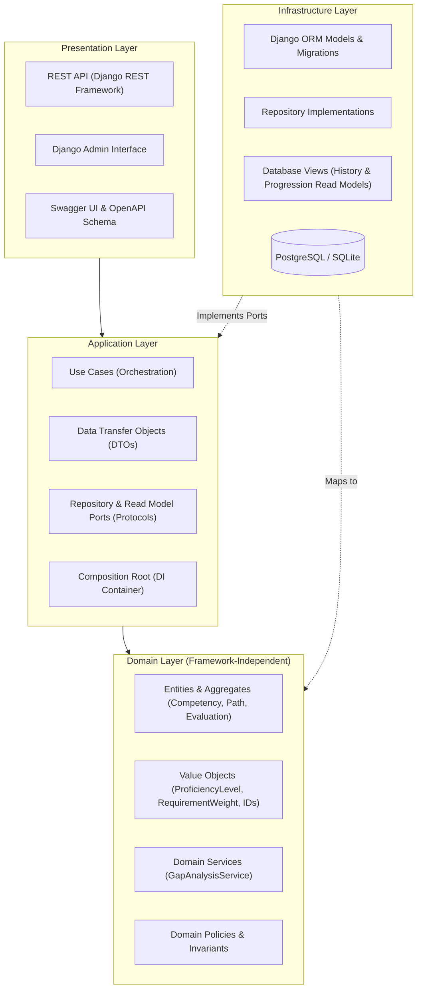

# Personnel Competency Analysis System

[](https://www.python.org/)
[](https://www.djangoproject.com/)
[](https://github.com/astral-sh/ruff)
[]()
[]()

A production-grade personnel competency analytics and career progression platform engineered in Python following **SOLID**, **Domain-Driven Design (DDD)**, and **Clean Architecture** principles.

The system allows organizations to define competency catalogs, configure hierarchical career paths with weighted proficiency requirements, conduct periodic 360/leader evaluations with strict immutability workflows, and compute real-time competency gap analytics and promotion eligibility.

---

## Table of Contents

- [Architectural Overview](#architectural-overview)
- [Key Features](#key-features)
- [Domain Concepts](#domain-concepts)
- [Tech Stack](#tech-stack)
- [Project Structure](#project-structure)
- [Getting Started](#getting-started)
  - [Prerequisites](#prerequisites)
  - [Local Installation](#local-installation)
  - [Docker Setup](#docker-setup)
- [API Documentation](#api-documentation)
- [Dependency Injection & Composition Root](#dependency-injection--composition-root)
- [Development & Quality Assurance](#development--quality-assurance)

---

## Architectural Overview

The core domain logic is strictly decoupled from frameworks, persistence mechanisms, and transport protocols. Django and Django REST Framework function exclusively as outer-layer adapters (Infrastructure and Presentation).



### Dependency Rules
1. **Domain**: Zero framework imports (`django`, `rest_framework`, `pydantic`). Encapsulates pure business invariants and entities.
2. **Application**: Coordinates use cases using domain abstractions (`Protocol`). Decoupled from concrete storage engines and web servers.
3. **Infrastructure**: Implements repository and query ports via Django ORM and PostgreSQL/SQLite database views.
4. **Presentation**: Translates HTTP requests/responses, validates payloads via DRF serializers, and invokes application use cases through the DI container.

---

## Key Features

- **Competency Catalog Management**:
  - Hierarchical classification with Categories, Competency Groups, and Competencies.
  - Multi-level proficiency matrices (Levels 1 to 5) with behavioral descriptive anchors.
  - Deletion protection ensuring active competencies referenced in paths or evaluations cannot be deleted.

- **Career Progression Paths**:
  - Linear or branched career paths with progressive levels (Junior, Mid, Senior, Lead).
  - Explicit competency requirements per level with weighted significance (`MANDATORY` vs `OPTIONAL`).
  - Active path enrollment tracking with automated deactivation of historical enrollments upon switching.

- **Periodic Performance Evaluations**:
  - Multi-status lifecycle: `DRAFT` &rarr; `COMPLETED` &rarr; `ACCEPTED` or `CONTESTED`.
  - Enforced immutability: once submitted or finalized, measurements cannot be modified or deleted.
  - Contestation workflow requiring documented justification notes.

- **Real-Time Competency Gap Analysis**:
  - Algorithmic gap calculation: $\text{Gap} = \max(0, \text{Required Level} - \text{Current Level})$.
  - Unmeasured competencies automatically defaulted to level 0.
  - Weighted overall match percentage calculation.
  - Deterministic promotion readiness assessment.

- **Optimized SQL Read Models**:
  - `collaborator_competency_history`: Longitudinal view of employee skill evolution across evaluation cycles.
  - `path_progression_summary`: Aggregated completion rates, gap counts, and eligibility indicators.

---

## Domain Concepts

```text
Category
   └── CompetencyGroup
            └── Competency (Levels 1–5)
                     ▲
                     │ (referenced by)
CompetencyPath       │
   └── PathLevel ────┴── CompetencyRequirement (minimum_level, MANDATORY/OPTIONAL)
         ▲
         │ (enrolled in)
Collaborator
   ├── PathEnrollment (active/inactive status, enrollment_date)
   └── Evaluation (status: DRAFT, COMPLETED, ACCEPTED, CONTESTED)
            └── CompetencyMeasurement (current_level)
```

---

## Tech Stack

- **Language**: Python 3.12+ (managed with `uv`)
- **Web Framework**: Django 6.1.3
- **API Engine**: Django REST Framework (DRF)
- **API Documentation**: OpenAPI 3.0 via `drf-spectacular` (Swagger UI & ReDoc)
- **Database**: PostgreSQL 16 (production/docker) & SQLite (testing)
- **Code Quality**:
  - Linter & Formatter: `Ruff` (line-length: 88, PEP 8)
  - Static Type Checker: `Pyrefly`
  - Test Suite: `pytest`, `pytest-django`, `pytest-cov`

---

## Project Structure

```text
src/
├── domain/                    # Pure domain models and business rules
│   ├── entities/              # Collaborator, Competency, Evaluation, Path
│   ├── value_objects/         # ProficiencyLevel, Weight, IDs
│   ├── services/              # GapAnalysisService, eligibility rules
│   ├── repositories/          # Domain repository protocols
│   └── exceptions/            # Domain-specific business exceptions
│
├── application/               # Application orchestration & use cases
│   ├── use_cases/             # CQRS-style Use Cases
│   ├── dto/                   # Request/Response Data Transfer Objects
│   ├── ports/                 # Read model interfaces & output contracts
│   └── exceptions/            # Application errors (NotFound, Conflict)
│
├── infrastructure/            # Framework implementations & persistence
│   ├── django/
│   │   ├── models/            # Separated ORM models (1 per file)
│   │   ├── repositories/      # Django ORM implementations of domain ports
│   │   ├── read_models/       # Database SQL views for queries
│   │   ├── admin/             # Django Admin configurations
│   │   └── migrations/        # Database schema migrations
│   └── config/                # Django settings, WSGI/ASGI configurations
│
├── presentation/              # Delivery mechanisms
│   ├── api/
│   │   ├── views/             # DRF ViewSets (thin controllers)
│   │   ├── serializers/       # Request/Response serializers
│   │   ├── urls.py            # API routing & OpenAPI endpoints
│   │   └── exceptions.py      # Custom DRF exception handler
│   └── dependencies/
│       └── container.py       # Composition Root / Dependency Injection
│
tests/
├── unit/                      # Fast, framework-free unit tests
├── integration/               # Database, ORM, repository & workflow tests
├── api/                       # DRF endpoint & HTTP status code tests
└── e2e/                       # Full end-to-end user journey tests
```

---

## Getting Started

### Prerequisites

- [uv](https://docs.astral.sh/uv/) (recommended fast Python package manager)
- Python 3.12 or newer
- Docker & Docker Compose (optional, for running PostgreSQL)

### Local Installation

1. **Clone the repository**:
   ```bash
   git clone git@github.com:higorrsc/competency-analytics.git
   cd competency-analytics
   ```

2. **Install dependencies**:
   ```bash
   uv sync
   ```

3. **Configure Environment Variables**:
   ```bash
   cp .env.example .env
   # Adjust settings if using an external PostgreSQL instance
   ```

4. **Run Database Migrations**:
   ```bash
   uv run python manage.py migrate
   ```

5. **Create an Administrator User**:
   ```bash
   uv run python manage.py createsuperuser
   ```

6. **Start the Development Server**:
   ```bash
   uv run python manage.py runserver
   ```
   Access the application:
   - Web API: [http://127.0.0.1:8000/api/v1/](http://127.0.0.1:8000/api/v1/)
   - Swagger Documentation: [http://127.0.0.1:8000/api/docs/](http://127.0.0.1:8000/api/docs/)
   - Django Admin: [http://127.0.0.1:8000/admin/](http://127.0.0.1:8000/admin/)

---

### Docker Setup

To run the application with a PostgreSQL database container:

```bash
# Start PostgreSQL service
docker compose up -d db

# Apply migrations
uv run python manage.py migrate

# Start development server
uv run python manage.py runserver
```

---

## API Documentation

Interactive API documentation is automatically generated from DRF ViewSets and domain schemas:

| Documentation UI | Endpoint | Description |
|---|---|---|
| **Swagger UI** | `/api/docs/` | Interactive API explorer & testing client |
| **ReDoc** | `/api/redoc/` | Clean, structural API reference |
| **OpenAPI Spec** | `/api/schema/` | Raw OpenAPI 3.0 YAML/JSON specification |

### Main Endpoints

| Resource | HTTP Method | Endpoint | Description |
|---|---|---|---|
| **Categories** | `GET`, `POST` | `/api/v1/categories/` | List or create competency categories |
| **Competencies** | `GET`, `POST` | `/api/v1/competencies/` | Catalog competencies with level definitions |
| **Competencies** | `GET`, `PUT`, `DELETE`| `/api/v1/competencies/{id}/` | Retrieve, update, or safely delete competency |
| **Career Paths** | `GET`, `POST` | `/api/v1/paths/` | Career paths and progression levels |
| **Collaborators**| `GET`, `POST` | `/api/v1/collaborators/` | Employee profiles and active path enrollments |
| **Evaluations**  | `GET`, `POST` | `/api/v1/evaluations/` | Create and list evaluations |
| **Evaluations**  | `POST` | `/api/v1/evaluations/{id}/submit/` | Submit evaluation for finalization |
| **Evaluations**  | `POST` | `/api/v1/evaluations/{id}/accept/` | Accept evaluation (final status) |
| **Evaluations**  | `POST` | `/api/v1/evaluations/{id}/contest/`| Contest evaluation with notes |
| **Gap Analysis** | `GET` | `/api/v1/collaborators/{id}/gap-analysis/` | Calculate competency gaps and promotion readiness |
| **History View** | `GET` | `/api/v1/collaborators/{id}/history/` | Longitudinal skill evolution timeline |
| **Progression**  | `GET` | `/api/v1/collaborators/{id}/progression/` | Path completion rate and status |

---

## Dependency Injection & Composition Root

The application adheres strictly to the **Dependency Inversion Principle (DIP)**. Use cases depend only on domain repository protocols (`src/domain/repositories/`) and read model ports (`src/application/ports/`), remaining completely decoupled from Django ORM models and database drivers.

The Composition Root is located at `src/presentation/dependencies/container.py`:

```python
from src.presentation.dependencies import get_container, set_container, Container
from tests.unit.application.use_cases.fakes import FakeCompetencyRepository

# 1. Resolving the default container in presentation controllers:
container = get_container()
competency = container.get_competency_use_case.execute(competency_id)

# 2. Seamless test double substitution:
fake_repo = FakeCompetencyRepository()
test_container = Container(competency_repository=fake_repo)
set_container(test_container)
```

---

## Development & Quality Assurance

### Running Tests

```bash
# Run the complete test suite (unit, integration, api, e2e)
uv run pytest

# Run with test coverage report
uv run pytest --cov=src --cov-report=term-missing
```

### Static Analysis & Formatting

```bash
# Format code (Ruff)
uv run ruff format .

# Run linter checks
uv run ruff check .

# Run static type checking (Pyrefly)
uv run pyrefly check
```

For more details on contribution workflows, pre-commit hooks, and architecture conventions, refer to the [Development Guide](docs/development-guide.md) and [Architecture Guide](docs/architecture.md).
