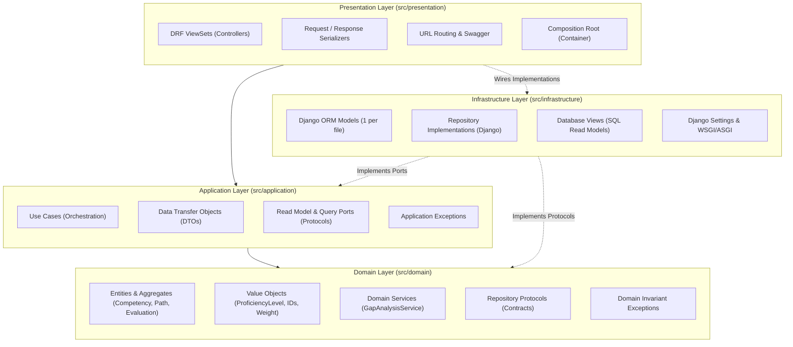
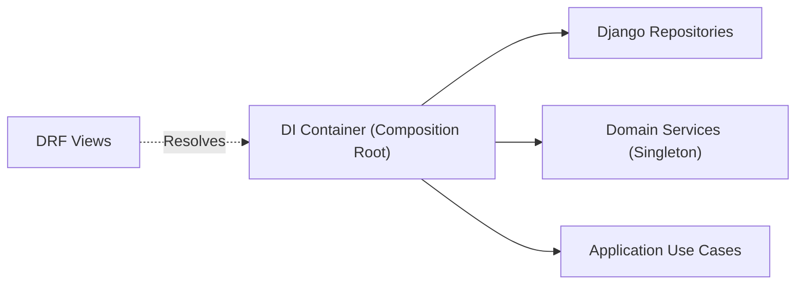

# Architecture Guide

This document details the software architecture, design patterns, and structural boundaries governing the **Personnel Competency Analysis System**.

The application is structured according to **Clean Architecture** (Robert C. Martin), **Domain-Driven Design (DDD)** (Eric Evans), and **SOLID** principles.

---

## Table of Contents

- [Architectural Philosophy](#architectural-philosophy)
- [Layer Overview](#layer-overview)
- [Dependency Direction & Boundaries](#dependency-direction--boundaries)
- [Layer Details](#layer-details)
  - [1. Domain Layer](#1-domain-layer)
  - [2. Application Layer](#2-application-layer)
  - [3. Infrastructure Layer](#3-infrastructure-layer)
  - [4. Presentation Layer](#4-presentation-layer)
- [Dependency Injection & Composition Root](#dependency-injection--composition-root)
- [Cross-Cutting Concerns](#cross-cutting-concerns)
- [Verification & Architectural Constraints](#verification--architectural-constraints)

---

## Architectural Philosophy

The core premise of Clean Architecture is the **Independence of Frameworks**:
The architecture does not depend on the existence of some library of feature-laden software. This allows you to use such frameworks as tools, rather than having to cram your system into their limited constraints.

In this project:

- **Django is an infrastructure and delivery mechanism**, not the application itself.
- Business rules and policies reside solely in the **Domain** and **Application** layers.
- ORM models, SQL queries, HTTP handlers, serializers, and external libraries are outer adapters.

---

## Layer Overview



---

## Dependency Direction & Boundaries

The dependency rule states that source code dependencies must point only inward toward higher-level policies:

$$\text{Presentation} \longrightarrow \text{Application} \longrightarrow \text{Domain} \longleftarrow \text{Infrastructure}$$

### The Golden Invariant

The **Domain Layer** must have **zero external framework dependencies**:

```python
# FORBIDDEN in src/domain/:
import django  # ❌
import rest_framework  # ❌
import pydantic  # ❌
import sqlalchemy  # ❌
```

Any attempt to import Django ORM models or web framework components into `src/domain/` violates architectural purity and breaks test isolation.

---

## Layer Details

### 1. Domain Layer

The Domain Layer (`src/domain/`) encapsulates the enterprise business concepts and invariants.

#### Entities & Aggregates

Domain entities are non-anemic classes containing rich business methods that enforce invariants:

- `Competency`: Proficiency levels (1–5), categorization, and immutable definitions.
- `CompetencyPath`: Career tracks, hierarchical path levels, and weighted competency requirements.
- `Collaborator`: Employee profile with active path enrollment tracking. Enforces the rule that **only one career path can be active at a time**.
- `Evaluation`: Performance assessment lifecycle (`DRAFT` &rarr; `COMPLETED` &rarr; `ACCEPTED` or `CONTESTED`). Enforces measurement immutability once finalized.

```python
# Example: Enforcing domain invariants inside entity
def submit(self, submitted_at: datetime) -> None:
    if self.status != EvaluationStatus.DRAFT:
        raise EvaluationFinalizedError(
            f"Cannot submit evaluation with status '{self.status.value}'"
        )
    self.status = EvaluationStatus.COMPLETED
    self.submitted_at = submitted_at
```

#### Value Objects

Immutable primitives with domain semantics and validation:

- `ProficiencyLevel`: Validates proficiency integer in range $[1, 5]$.
- `RequirementWeight`: Enumerates significance (`MANDATORY`, `OPTIONAL`).
- `EvaluationStatus`: State transitions (`DRAFT`, `COMPLETED`, `ACCEPTED`, `CONTESTED`).
- Strongly typed IDs: `CompetencyId`, `PathId`, `CollaboratorId`, `EvaluationId`.

#### Domain Services

Domain services perform calculations or logic that naturally span multiple entities:

- `GapAnalysisService`: Pure mathematical calculation of competency gaps:
  $$\text{Gap} = \max(0, \text{Required Level} - \text{Measured Level})$$
  Computes weighted match percentage and promotion readiness without framework or database calls.

#### Repository Protocols

Domain repository contracts are defined using `typing.Protocol`, decoupling business operations from concrete storage:

- `CompetencyRepository`
- `PathRepository`
- `CollaboratorRepository`
- `EvaluationRepository`

---

### 2. Application Layer

The Application Layer (`src/application/`) coordinates the workflow of use cases:

1. Accepts typed input parameters or Input DTOs.
2. Invokes domain repository protocols to load entities.
3. Triggers domain methods to execute business rules.
4. Persists updated entity state back through repositories.
5. Emits typed Response DTOs.

#### Use Cases

CQRS-inspired application use cases:

- `CalculateCompetencyGapsUseCase`: Orchestrates evaluation measurements and path requirements through `GapAnalysisService`.
- `EnrollCollaboratorUseCase`: Manages career path enrollment and automated historical deactivation.
- `SubmitEvaluationUseCase`, `AcceptEvaluationUseCase`, `ContestEvaluationUseCase`: Manages evaluation lifecycle transitions.
- Catalog query and mutation use cases (`CreateCompetencyUseCase`, `DeleteCompetencyUseCase`, etc.).

#### Ports

Defines output contracts for specialized read-side queries and database views:

- `CompetencyHistoryReadModel`: Protocol for querying longitudinal skill evolution timelines.
- `PathProgressionReadModel`: Protocol for querying career path advancement summaries.

---

### 3. Infrastructure Layer

The Infrastructure Layer (`src/infrastructure/`) fulfills contracts defined by inner layers:

#### Django ORM Models

- Separated into **one file per model** under `src/infrastructure/django/models/` for modularity and maintainability.
- Django models are persistence models, not domain models. They handle database constraints, indexes, and relational integrity.

#### Repositories

Implement domain repository protocols (`DjangoCompetencyRepository`, `DjangoPathRepository`, etc.):

- Responsible for bidirectional translation between Django ORM models and pure domain entities.
- Ensures domain entities never leak ORM state or database queries.

#### Read Models & Database Views

- Raw SQL / Django Managed Views (`collaborator_competency_history`, `path_progression_summary`) optimizing complex analytical queries without traversing relational object graphs.

---

### 4. Presentation Layer

The Presentation Layer (`src/presentation/`) handles HTTP transport, serialization, and input validation:

#### Django REST Framework ViewSets

- Act as **thin controllers**.
- Validate incoming JSON payloads via DRF Serializers.
- Delegate all business execution directly to Application Use Cases.
- Map DTO results to JSON responses.

#### Exception Handler

A centralized exception handler (`src/presentation/api/exceptions.py`) maps domain and application exceptions to appropriate HTTP status codes:

- `NotFoundError` &rarr; `404 Not Found`
- `ConflictError` / `EvaluationFinalizedError` / `CompetencyReferencedError` &rarr; `409 Conflict`
- `ValidationError` / `InvalidProficiencyLevelError` &rarr; `400 Bad Request`

---

## Dependency Injection & Composition Root

The application follows the **Dependency Inversion Principle (DIP)** using a Composition Root located at:
[`src/presentation/dependencies/container.py`](file:///home/higorrsc/dev-disk/portfolio/competency-analytics/src/presentation/dependencies/container.py)



### Benefits

1. **Zero Framework Coupling**: Use cases can be tested in isolation using lightweight in-memory fake repositories in milliseconds.
2. **Deterministic Wiring**: All dependencies are instantiated in a single, predictable location.
3. **Pluggable Architecture**: Infrastructure implementations (PostgreSQL, SQLite, Mongo, In-Memory) can be swapped without touching a single line of business logic.

---

## Cross-Cutting Concerns

- **Observability & Logging**: Structured logging at use case and exception boundaries.
- **Data Validation**: Multi-tiered validation:
  1. Serializer layer: Schema, data types, and required fields.
  2. Domain layer: Business invariants and domain range boundaries.
  3. Database layer: Relational integrity, foreign keys, and unique constraints.

---

## Verification & Architectural Constraints

The repository enforces architectural constraints through automated gates:

| Verification | Tool | Command |
| --- | --- | --- |
| Domain Isolation | Pytest Unit Tests | `uv run pytest tests/unit/domain/` (0 framework imports) |
| Line Length (<= 88) | Ruff | `uv run ruff check .` / `uv run ruff format .` |
| Strict Static Typing | Pyrefly | `uv run pyrefly check` |
| End-to-End Workflows | Pytest E2E | `uv run pytest tests/e2e/` |
